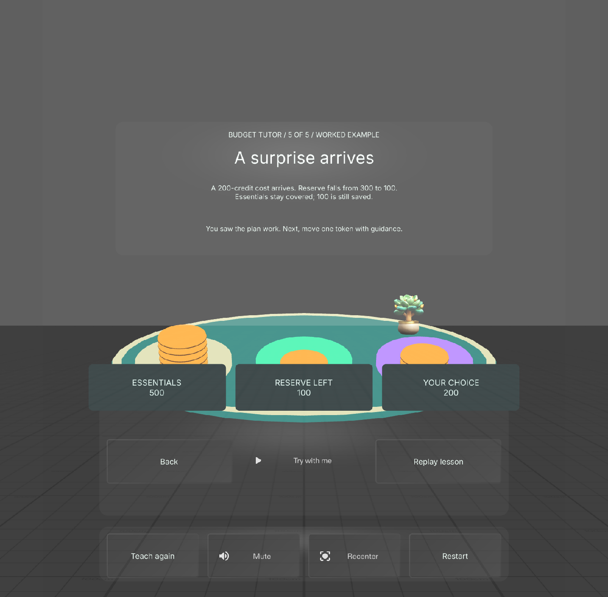

# Money Garden

A Specs AR tutor for a broad audience. Learn budgeting, progressive tax layers, and AND/OR decision logic through explanations and worked examples in a miniature garden, followed by guided practice.

## Run

Open `Learn_AR_with_Specs.esproj` in Lens Studio 5.24.1 or a compatible version, allow assets to import, and use the SPECS27 Interactive Preview. Select **Start growing** to meet the tutor. Mouse interaction simulates standard SIK pinch input.

Each lesson follows **explanation → visible worked example → guided practice → prediction and feedback**. Use Next and Back to set the teaching pace. The budget demonstration allocates money and absorbs a surprise; the tax demonstration builds each income layer; the logic demonstration contrasts AND and OR with the same conditions. Questions appear after teaching.

During practice, **Teach again** replays the explanation using separate demonstration state and returns to your preserved work. The sequence ends with three takeaways. Replay resets the current scenario; New scenario cycles through three solvable budgets. Details, mute, recenter, and restart remain available.

## Verified behavior

All eight LEAF acceptance scenarios passed for the tutor revision: tutor flow and state preservation, practice drag/drop, budgeting, tax arithmetic, all eight AND/OR cases, full replay across three scenarios, utility controls, and IK interaction. Native compilation and startup checks passed. Replay completed in 125.823 seconds, beyond the tool's 120-second response window; its authoritative LEAF pass and final state were verified in the native log. See [verification details](devpost/verification.md) for evidence and limits.

The IK check used **indirect/far-field interaction at 115 cm**. It does not prove direct arm reach, real-device comfort, or physical hand tracking. No hardware demonstration is claimed. The tabletop is virtual, not detected furniture; progress is within the current session.

## Learning content

All amounts are fictional credits. Tax rates and thresholds are practice examples, not a real tax schedule or a filing calculator. The budgeting reserve is a scenario condition, not a universal recommendation. [Content sources and exact examples](devpost/learning-sources.md) document the teaching model.

## Build and submission materials

- [Approved design brief](devpost/design-brief.md)
- [Run and demo guide](devpost/run-and-demo.md) and [timed narration](devpost/demo-narration.md)
- [Asset provenance and licenses](devpost/asset-provenance.md)
- [Submission draft](devpost/submission-draft.md) and [readiness checklist](devpost/submission-checklist.md)

Built with Codex, CLAD, native Lens Studio MCP tools, TypeScript, SpectaclesInteractionKit, SpectaclesUIKit, and LEAF. Runtime geometry uses MeshBuilder; the plant and audio were generated through CLAD workflows. Preserve third-party package notices and the included font/icon licenses.

`Assets/Scripts` contains the lesson code; `Assets/Tests` contains the LEAF scenario and index. Open the LEAF panel in Lens Studio to run the `money-garden-*` scenarios. Scenarios use real SIK controls and read-only state snapshots rather than calling private lesson handlers.
