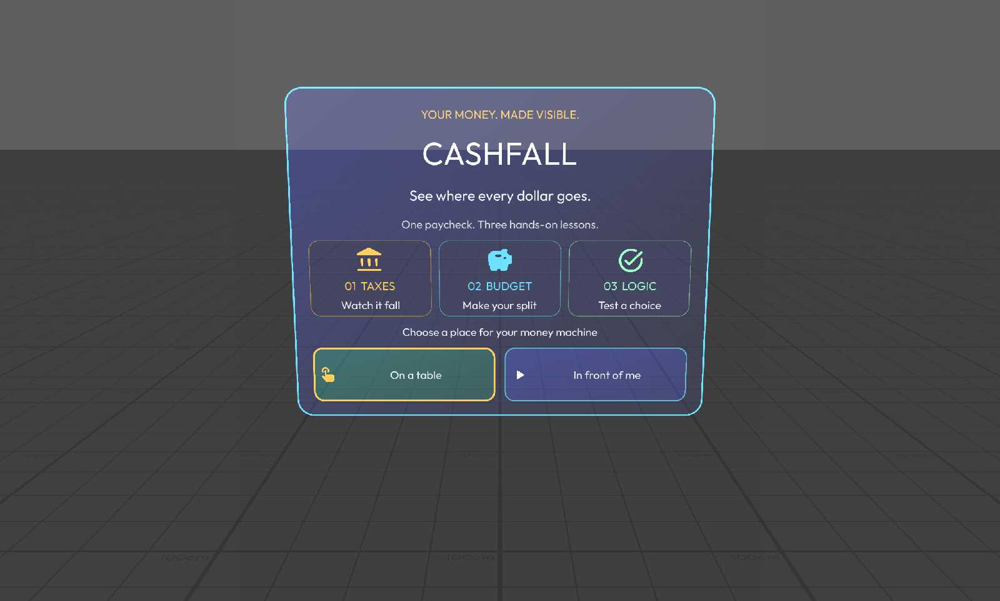

# Cashfall

A Specs AR lesson in money. You place a small money machine on your table, your paycheck falls through tax steps, you split what is left into jars with your hands, and a purchase has to pass a logic gate before it goes through. Three chapters, one machine, one month. Built for a broad audience with no prior finance or logic background.

## Run it

Open `Learn_AR_with_Specs.esproj` in Lens Studio 5.24.1 (or newer 5.2x), let assets import, and use the SPECS27 Interactive Preview. The welcome card introduces Taxes, Budget, and Logic with illustrated lesson cards. Choose **On a table** (aim at a flat surface and pinch) or **In front of me**. Mouse clicks in the Preview stand in for pinches. The machine stays world-locked where you put it; the **bring it here** dock button re-centres it without losing progress.

## The experience

1. **Place.** A head-relative welcome card offers surface placement through the WorldQuery hit test (reticle on the table, pinch to commit) or a fallback pose in front of you. The machine assembles with a pop-in.
2. **Chapter 1, The Falls (taxes).** The paycheck lands in the hopper and falls down three terraces: the first $1,000 at 0%, $1,000 to $3,000 at 10%, above $3,000 at 20%. Each terrace holds the slice that landed on it, with the taxed part shown in coral; the skimmed coins arc into the tax tube on the right and the rest lands in the take-home basin. Step through the four explanations, then explore with **+ $500 / − $500** while the tube, pools, and chips update live. A myth check asks whether a raise that reaches the 20% step can lower take-home pay; the machine then runs the raise and shows +$500 gross becoming +$400 take-home, with marginal and effective rate side by side.
3. **Chapter 2, The Split (budget).** Take-home becomes ten coins. Pinch the floating coin and drop it into NEEDS, WANTS or SAVE, or tap a jar to send a coin there. Rings mark a 50 / 30 / 20 guide, Undo and a one-tap 50/30/20 are always available. **Run the month** pays essentials first, then a surprise bill drops onto SAVE. If the cushion is too small the bill raids WANTS and any remainder is called out as uncovered. Retry is one tap. Then the growth reveal: the monthly SAVE amount compounded at 5% for 10 years rises as a coin column, with contributions and growth separated.
4. **Chapter 3, The Gate (logic).** A purchase shows up. Check A (needs covered) and check B (the cushion survives the purchase) light up from the learner's own split. Predict whether the AND gate opens, run the cart, then fill the 8-row truth table with override toggles for A, B and AND/OR. Finally pick the operator that enforces "both checks must pass".
5. **Summary.** Your month on four chips plus three takeaways. **Replay**, **New scenario** (three deterministic scenarios: First paycheck, The raise, Side hustle) or **Free play** (rebuild the split and rerun the month and gate as often as you like).

All amounts are fictional practice credits shown as dollars. The tax steps are practice rates, not a real schedule, and the lesson is not financial advice.

## Specs features

- **WorldQuery surface placement** with a smoothed reticle, surface-tilt rejection and a camera-relative fallback (`CashfallPlacement.ts`).
- **SIK hand interaction**: UIKit buttons for every control, a grabbable coin with `InteractableManipulation` snapping to the nearest jar, and jar colliders that respond to pinch and hover.
- **World-locked spatial layout**: the machine, console and value chips share one root; the console lies in front of the machine tilted toward the viewer like a lectern.
- **Spatial audio**: a pool of emitters is moved to the part that makes each sound (coins at the jars, the gate thunk at the gate), with an ambient bed and a mute control.
- **Out-of-view recovery**: if the machine leaves the view for a few seconds the welcome card returns with a one-tap recenter.
- **Code-authored geometry**: every part of the machine is MeshBuilder geometry with baked vertex shading on one unlit material (`CashfallShapes.ts`, `CashfallMachine.ts`).

## Design

Night-market fintech: deep indigo cards with glowing cyan and gold edges, white Outfit type, gold coins, mint/gold/coral rate colours and cyan/lavender/mint jars. Every control is a custom-styled UIKit `Button` (`RoundedRectangleVisual` gradients and borders with hover and press states) with a Material icon. Chapter tabs, a kicker, a title, body copy and a toned note (gold neutral, mint success, coral alert) make up the console. Value chips float beside the parts they describe. Colour never carries an answer alone; every state is also written out.

## Verified in Preview

The whole flow was driven with real SIK pinches in the Lens Studio Preview through the AiPreviewAgent tooling: placement, all four tax steps, the explore controls at $4,000 to $5,500, the myth check and raise demo, jar taps and a coin drag, the month run (needs paid, $650 surprise out of a $720 cushion), the growth reveal, the AND prediction, truth-table rows T AND F and T AND T, the policy question and the summary. No script errors or warnings were logged. Physical-device checks were not performed; see [devpost/verification.md](devpost/verification.md).

## Project layout

- `Assets/Scripts/CashfallMain.ts` — orchestrator: pages, lesson state, audio, wiring.
- `Assets/Scripts/CashfallModel.ts` — pure lesson math: brackets, scenarios, month rules, gate truth, compound growth.
- `Assets/Scripts/CashfallMachine.ts` — the machine: geometry, coin pool, stage swaps, animations.
- `Assets/Scripts/CashfallShapes.ts` — MeshBuilder kit (lathe, box, slab, pipe, coin, ring) with baked shading.
- `Assets/Scripts/CashfallConsoleUI.ts`, `CashfallLabelsUI.ts`, `CashfallIntroUI.ts` — UIKit views.
- `Assets/Scripts/CashfallPlacement.ts` — WorldQuery reticle and fallback placement.
- `Assets/Scripts/CashfallAudio.ts`, `CashfallTween.ts` — spatial audio pool, tweens, formatting.
- `Assets/GeneratedSFX/` — algorithmically synthesised cues and the ambient bed (`tempAssetGen/` holds the generator scripts).
- `Assets/Icons/`, `Assets/Fonts/Outfit.ttf` — Material Symbols imported through Lens Studio; Outfit from Google Fonts.
- `devpost/` — design brief, verification notes, screenshots, asset provenance.

An earlier prototype (Money Garden) was archived outside this repository before Cashfall was built from scratch on November 8, 2026.

Built with Claude Code and the CLAD toolkit (Lens Studio MCP tools), TypeScript, SpectaclesInteractionKit and SpectaclesUIKit.
